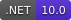
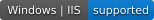
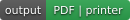
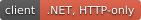
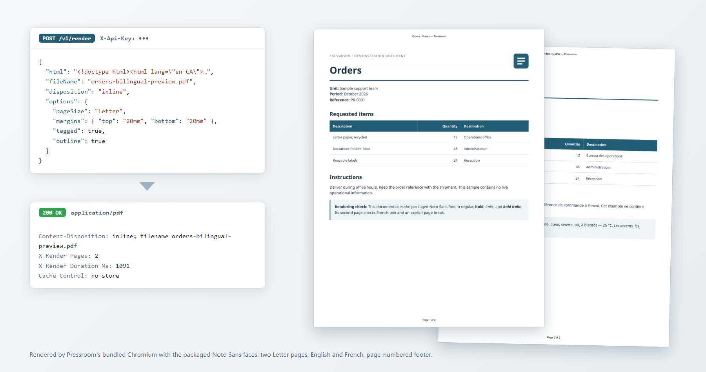

<h1 align="center">Pressroom</h1>

<p align="center">
  An HTML-to-PDF service for Windows, IIS, Linux, and containers.<br>
  An application <code>POST</code>s one complete HTML document; Pressroom returns print-quality PDF bytes,
  or sends the pages straight to an allowlisted Windows or Linux printer.
</p>

<p align="center">
  <a href="LICENSE"></a>
  
  
  
  
  
  <a href="docs/container.md"></a>
  <a href="https://github.com/auroris/Pressroom/releases/latest"></a>
</p>



<p align="center">
  <strong><a href="https://github.com/auroris/Pressroom/releases/latest">⬇ Download the latest release</a></strong>
</p>

## What it is

Pressroom is a standalone .NET 10 service that turns a complete HTML document into
a PDF. A release is **one folder**: the server, its private Playwright driver and
Node runtime, the matching Chromium headless shell, and the Noto Sans fonts, all
pinned together with a manifest of file hashes. For IIS, install the .NET 10
Hosting Bundle and deploy the complete release folder. The packaged renderer and
fonts keep each installation on the versions tested for that release.

- **One request, one PDF.** Send `html`, get `application/pdf` with the page count
  and render time in the headers. Your application controls delivery to the browser.
- **Paper-aware output.** Named and custom page sizes, margins, scale, print or
  screen media, running headers and footers with page numbers, tagged PDF, and a
  document outline built from your headings.
- **Predictable typography.** Noto Sans in four faces is packaged and injected into
  every document; embed anything else as a `data:` font.
- **Isolated renders.** Documents are self-contained by rule: only `data:`
  resources load, network and file access are blocked before parsing, scripts are
  off unless the caller's key opts in, and every render gets a fresh sandboxed
  browser context.
- **Print on Windows or Linux.** Add a `printer` identifier and Pressroom hands the
  pages to an allowlisted queue through SumatraPDF or CUPS, returning a submission receipt.
- **Access control.** Named API keys with per-key JavaScript permission, or
  explicit anonymous mode for a trusted network. Health stays anonymous for IIS
  warm-up and probes.
- **Built for operations.** Stateless, bounded queue with `Retry-After`, one
  end-to-end deadline per request, planned browser recycling, metadata-only logs,
  an offline `--check` self-test, and stop-copy-start upgrades with folder rollback.
- **HTTP integration for .NET.** `Pressroom.Client` handles requests, validation,
  streaming, and errors for .NET 8 and .NET 10 applications.
- **Opt-in batch jobs.** Submit, poll, download or cancel durable jobs. Per-key
  scheduling reserves capacity for interactive requests; local retention is bounded.
- **Linux and containers.** Sandboxed Linux x64 packages, a non-root container,
  and external JSON configuration. See [Linux](docs/linux.md) and optional
  network isolation in [containers](docs/container.md).

## Choose a deployment

- **Internet-facing use:** use the [Linux Docker image with the documented iptables
  isolation](docs/container.md#optional-linux-outbound-isolation), API-key authentication,
  and an HTTPS reverse proxy in front of the loopback-bound API. A
  [direct Linux installation](docs/linux.md) is also suitable when it runs under
  a dedicated unprivileged user; use API keys and HTTPS there too.
- **Intranet use:** Windows/IIS installations and Windows containers are intended
  primarily for internal networks. Both Linux deployment options also work on intranets.

Network isolation remains an optional deployment setting; enable it for the
recommended internet-facing Docker setup. See the [security model](docs/security.md).

## Quick start

This example uses a direct Windows installation for an intranet.

Download and verify the latest release ZIP, then extract the whole archive into a
folder such as `C:\Sites\Pressroom`. Install the
[.NET 10 Hosting Bundle](https://learn.microsoft.com/en-us/aspnet/core/host-and-deploy/iis/hosting-bundle?view=aspnetcore-10.0)
if the server does not already have it.

Create `C:\ProgramData\Pressroom\pressroom.settings.json` with at least one API key
(start from [`samples/pressroom.settings.example.json`](samples/pressroom.settings.example.json)):

```json
{
  "Paths": { "StateRoot": "C:\\ProgramData\\Pressroom" },
  "Auth": {
    "Mode": "ApiKey",
    "ApiKeys": {
      "reporting-app": { "Secret": "REPLACE_WITH_A_RANDOMLY_GENERATED_SECRET" }
    }
  }
}
```

Check the package, then run it:

```powershell
& 'C:\Sites\Pressroom\Pressroom.Server.exe' --check
& 'C:\Sites\Pressroom\Pressroom.Server.exe' --urls http://localhost:5177
```

Render the bundled sample:

```sh
curl -sS -X POST http://localhost:5177/v1/render \
  -H "Content-Type: application/json" -H "X-Api-Key: REPLACE_WITH_YOUR_SECRET" \
  --data-binary @samples/orders-bilingual.request.json -o orders.pdf
```

Any HTTP client can call the API. The running service publishes its contract at
`/openapi/v1.json`, and each release also attaches `AurorisNet.Pressroom.Client`, an
HTTP-only .NET package for .NET 8 and .NET 10 that includes the contracts assembly.
The Packages workflow can optionally publish it to NuGet.org. See the
[client installation guide](docs/development/client.md#installing-the-package).

The [Getting started guide](docs/getting-started.md) walks through each step, and
the [Deployment guide](docs/deployment.md) covers the production IIS setup.

## Documentation

| Guide | Read it for |
|---|---|
| [Getting started](docs/getting-started.md) | From release package to first PDF: extract, configure a key, check, run, and render with curl or PowerShell. |
| [Configuration](docs/configuration.md) | The external settings file, access modes and API keys, JavaScript permission, limits, paths, logging, and upgrade notes. |
| [Printing](docs/printing.md) | Windows/SumatraPDF and Linux/CUPS setup, the printer allowlist, receipts, and local testing. |
| [Deployment on Windows and IIS](docs/deployment.md) | Server prerequisites, release contents, directories and permissions, IIS settings, first start, updating, and rollback. |
| [Linux](docs/linux.md) | Shared libraries, fonts, user namespaces, systemd, updates, rollback, and the acceptance checklist. |
| [Containers](docs/container.md) | Image tags, the sandboxed non-root Linux image, Compose, Kubernetes, Windows containers, and optional network isolation. |
| [Security model](docs/security.md) | Trust boundaries, document isolation, authentication, retention, resource limits, and deployment responsibilities. |
| [Windows / IIS acceptance](docs/windows-acceptance.md) | The checklist shipped with each release for qualifying a target server. |

These guides ship inside every release package. Material for application
developers and for people working on Pressroom itself, including the API reference,
the .NET client guide, the HTML authoring guide, build and release instructions, and
the design history, lives in the repository's `docs/development` folder.

## Developing

```sh
dotnet restore Pressroom.slnx --locked-mode
dotnet build Pressroom.slnx -c Release --no-restore
dotnet test --solution Pressroom.slnx -c Release
```

The prerequisites are the .NET 10 SDK and, for publishing, a Visual Studio release
that supports .NET 10 on Windows x64. Publishing acquires the browser payload used
by browser tests and releases. A manual GitHub Actions workflow builds releases;
the developer guide in `docs/development` has the details.

## License

[MIT](LICENSE). Redistributed components and their licences are listed in
[THIRD-PARTY-NOTICES.md](THIRD-PARTY-NOTICES.md).
